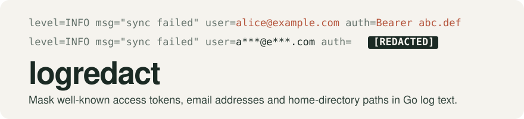
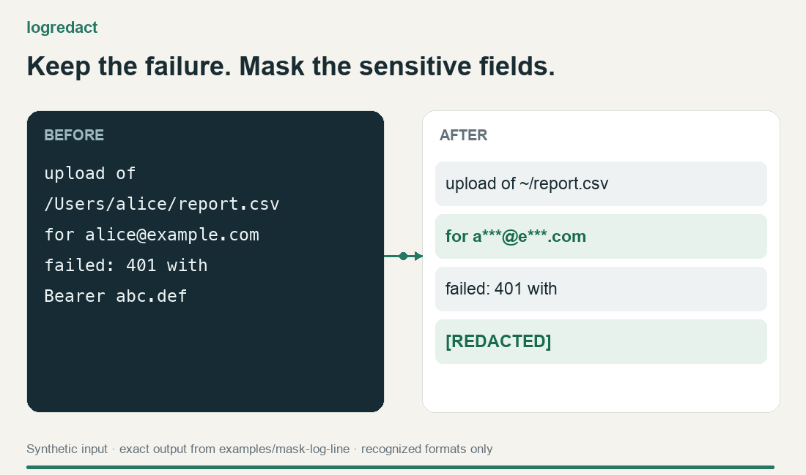
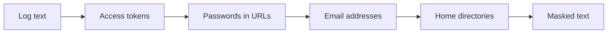

<picture>
  <source media="(prefers-color-scheme: dark)" srcset=".github/assets/banner-dark.svg">
  
</picture>

[](LICENSE)
[](go.mod)

<a href="https://www.producthunt.com/products/agentic-workflow-kit?embed=true&amp;utm_source=badge-featured&amp;utm_medium=badge&amp;utm_campaign=badge-tetriz-engineering-kit" target="_blank" rel="noopener noreferrer"></a>

If your Go service logs text it did not write, such as a user's payload or a third-party API's
error body, it can copy an access token or a customer's email address into logs that anyone
with log access can read. logredact masks the formats it recognises and keeps most of the line
readable, so the log still shows what went wrong.



Keep the error useful while masking recognized sensitive fields. [Demo details](.github/assets/demo/README.md).

## How it works

<details>
<summary>Implementation flow</summary>



logredact runs one rule per format, in the order shown. A token becomes `[REDACTED]`. An email
address or home directory is shortened, such as `a***@e***.com` or `~/report.csv`. The rest of
the line is kept, except that most token matches run to the next space.


</details>

## Quick start

You need Go 1.23 or later. It needs no services or credentials.

1. Add logredact to a module. In a module you already have, run only the `go get` line.

   ```sh
   mkdir try-logredact && cd try-logredact
   go mod init example.com/try-logredact
   go get github.com/tetriz-ai/logredact@latest
   ```

2. Save this program as `main.go` in that folder.

    ```go
    package main

    import (
    	"fmt"

    	"github.com/tetriz-ai/logredact"
    )

    func main() {
    	fmt.Println(logredact.Redact("upload of /Users/alice/report.csv for alice@example.com failed: 401 with Bearer abc.def"))
    	// upload of ~/report.csv for a***@e***.com failed: 401 with [REDACTED]
    }
    ```

3. Run it.

   ```sh
   go run .
   ```

   ```text
   upload of ~/report.csv for a***@e***.com failed: 401 with [REDACTED]
   ```

The home directory, the address and the Bearer credential are each masked. The rest of the line
still says what failed.

## What's in the box

| Use | When you want to |
|---|---|
| [`Redact`](docs/reference.md#redact) | Mask a log line, an error message or any other free text |
| [`RedactStruct`](docs/reference.md#redactstruct) | Log a protobuf `Struct` payload, masking values under names like `password` |
| [`VendorErrorDetail`](docs/reference.md#vendorerrordetail) | Quote a third-party API's error body, keeping only codes and request IDs |

### What it does not do

- **No guessing.** It masks only the formats in the [reference](docs/reference.md), not every random-looking string.
- **No Windows paths.** Only Unix-style home directories are recognised.
- **No logger integration.** You connect it to your logger yourself.

## Common tasks

### Mask a structured payload

String values under a [PII key](docs/reference.md#pii-keys), such as `password` or `email`, are masked
when longer than one character. Numeric secrets are masked when their decimal form is longer than
one character; other numbers, booleans and nulls are unchanged. Other strings get the usual rules.

```go
package main

import (
	"fmt"

	"github.com/tetriz-ai/logredact"
	"google.golang.org/protobuf/types/known/structpb"
)

func main() {
	payload, err := structpb.NewStruct(map[string]any{
		"event":    "login failed for bob@example.com",
		"password": "hunter2",
		"user":     map[string]any{"email": "bob@example.com", "id": 42},
	})
	if err != nil {
		panic(err)
	}
	logredact.RedactStruct(payload)
	fmt.Println(payload.AsMap())
	// map[event:login failed for b***@e***.com password:h*** user:map[email:b***@e***.com id:42]]
}
```

### Log an API error safely

Keep the code and request ID from an error body and drop the message that names a person, as
[examples/api-error-message](examples/api-error-message/) does for a failed HTTP response.

```go
package main

import (
	"fmt"

	"github.com/tetriz-ai/logredact"
)

func main() {
	body := []byte(`{"message":"Contact 'Jane Doe <jane@example.com>' already exists","code":"DUPLICATE","requestId":"req-7f3a"}`)
	fmt.Println(logredact.VendorErrorDetail(body))
	// code=DUPLICATE requestId=req-7f3a
}
```

### Mask recognized patterns in string log attributes

A `log/slog` `ReplaceAttr` hook passes string-valued attributes through `Redact`, as
[examples/slog-handler](examples/slog-handler/) shows. It does not inspect errors, slices or
other non-string values, or mask by attribute key: `"password", "hunter2"` is logged unchanged.

```go
package main

import (
	"log/slog"
	"os"

	"github.com/tetriz-ai/logredact"
)

func main() {
	redact := func(_ []string, a slog.Attr) slog.Attr {
		if a.Key == slog.TimeKey {
			return slog.Attr{} // dropped only so that the output below is stable
		}
		if a.Value.Kind() == slog.KindString {
			a.Value = slog.StringValue(logredact.Redact(a.Value.String()))
		}
		return a
	}
	logger := slog.New(slog.NewTextHandler(os.Stdout, &slog.HandlerOptions{ReplaceAttr: redact}))
	logger.Info("sync failed", "user", "alice@example.com", "auth", "Bearer abc.def")
	// level=INFO msg="sync failed" user=a***@e***.com auth=[REDACTED]
}
```

## Limitations

- Unlisted formats such as `password=hunter2` pass through, so add [your own rule](examples/custom-rules/) first.
- The AWS secret access key passes through, so keep it out of logs.
- A Bearer credential split onto the next line passes through, so log the header on one line.
- `RedactStruct` masks by name only under exact [PII key](docs/reference.md#pii-keys) names, and never masks map keys, so check your field names.
- `VendorErrorDetail` checks shape, not meaning, so `{"status":"Jane"}` gives `status=Jane`.

[docs/limitations.md](docs/limitations.md) describes design limits, each pinned by a test.

## More

- [Reference](docs/reference.md): every pattern, the PII keys and the allowlisted error-body keys.
- [Usage](docs/usage.md): notes for each function and the `slog` hook.
- [Limitations](docs/limitations.md) and [performance](docs/performance.md).
- [Examples](examples/README.md), each run by CI.
- [Contributing](CONTRIBUTING.md), including how to run the tests.
- [Security](SECURITY.md): report a vulnerability privately, not in a public issue.
- [MIT License](LICENSE).

Releases follow [Semantic Versioning](https://semver.org). A change to what is masked is breaking, and
before v1.0.0 it ships in a new minor version, as
[reference.md](docs/reference.md#versioning-and-compatibility) explains. Every release is in
[CHANGELOG.md](CHANGELOG.md).

Copyright 2026 Workloom Solutions Private Limited. Contributors are listed in [CONTRIBUTORS.md](CONTRIBUTORS.md).
